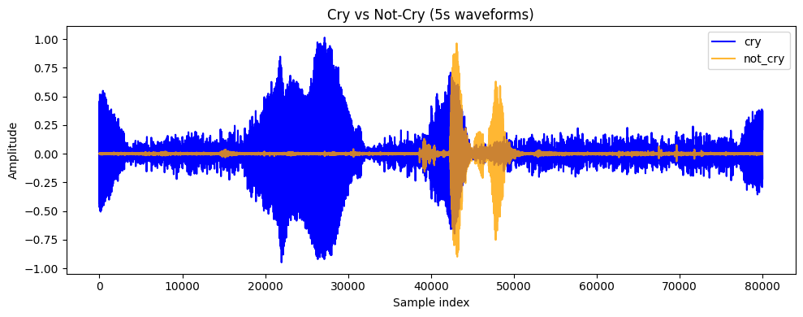
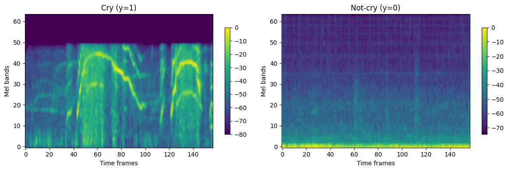
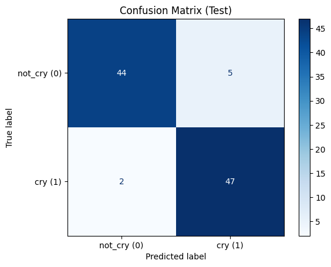
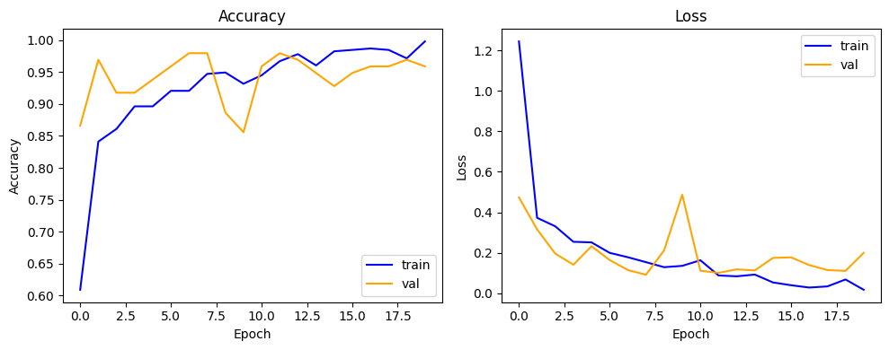
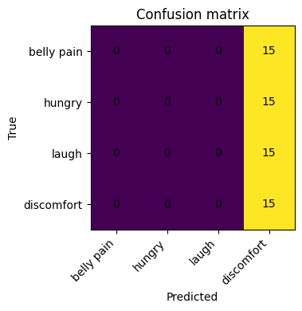

# Baby Cry Detection (Audio ML)

[](https://colab.research.google.com/github/suryaanarayanswamy/Baby-Cry-Detection/blob/main/Baby_Cry_Detection.ipynb)

An end-to-end audio classification pipeline that detects whether a real-world audio clip contains a **baby crying** or **not** (laughing, background noise, silence). Raw clips of mixed formats and lengths are standardized into fixed 5-second windows, converted to log-Mel spectrograms, and classified with a compact 2D CNN.

**Result: 92.86% test accuracy** on a held-out, class-balanced test set (91 of 98 clips correct).

The project also explores a harder extension, classifying the *type* of cry (belly pain, hungry, discomfort) with transfer learning, and documents why that problem turned out to be much harder.

---

## Dataset

[Baby Crying Sounds Dataset](https://www.kaggle.com/datasets/mennaahmed23/baby-crying-sounds-dataset) (Kaggle): **1,213 audio clips** across 9 categories.

| Group | Categories | Clips |
|---|---|---|
| Cry | belly pain, burping, cold_hot, discomfort, hungry, tired | 989 |
| Not cry | laugh, noise, silence | 324 |

For the binary task, 324 cry clips were used to match the 324 not-cry clips, giving a **balanced dataset of 648 clips**.

## The core challenge: messy audio

The raw data is not uniform:

- **Variable length:** clip durations differ, even within the same class.
- **Mixed formats:** `.wav`, `.ogg`, `.m4a`, `.mp3`.

A CNN needs every input in a batch to have the same shape, so preprocessing was most of the work.

### Avoiding label leakage

An early idea was to pad the shorter not-cry clips with silence or noise to match the longer cry clips. That would have created a **spurious correlation**: the model could learn "clips ending in 2 s of silence are not-cry" instead of learning what a cry sounds like. The final pipeline applies the **same** preprocessing to every clip, whatever its class.

## Pipeline

```
raw audio (any format/length)
   │  librosa.load → mono, resampled to 16 kHz
   ▼
5-second window (80,000 samples)
   │  shorter → zero-pad (centered)
   │  longer  → crop a 5 s window around the loudest region (RMS energy)
   ▼
log-Mel spectrogram  (64 Mel bands × 157 frames)
   │  n_fft=1024, hop=512, power_to_db
   ▼
2D CNN  →  P(cry)
```

Converting 80,000 raw samples to a 64 × 157 spectrogram (~10,000 values) makes the input smaller and gives the CNN an image-like representation of frequency over time.

| Waveforms | Log-Mel spectrograms |
|---|---|
|  |  |

## Model

A compact CNN (~646K parameters), built with TensorFlow/Keras:

```
Input (64, 157, 1)
Conv2D(16) → MaxPool
Conv2D(32) → MaxPool
Conv2D(64) → MaxPool
Flatten → Dense(64) → Dropout(0.3)
Dense(1, sigmoid)
```

- Split: 70% train / 15% validation / 15% test (stratified, `random_state=42`)
- Optimizer: Adam · Loss: binary cross-entropy · 20 epochs · batch size 16

## Results: cry vs. not cry

| Metric | Value |
|---|---|
| Test accuracy | **92.86%** |
| Cry recall | 95.9% (47 / 49) |
| Cry precision | 90.4% (47 / 52) |
| Misclassified clips | 7 / 98 |

| Confusion matrix | Training curves |
|---|---|
|  |  |

The notebook also shows spectrograms of the misclassified clips for error analysis.

## Extension: cry-type classification (transfer learning)

The next step was predicting *why* a baby is crying. The convolutional layers of the binary model were frozen and reused as a feature extractor, with a new classification head (Dense 128 + L2 + Dropout 0.4 + softmax), trained on a balanced set of 108 clips each from **belly pain, hungry, laugh and discomfort** (432 clips total).

**Result: 25% test accuracy**, which is chance level for 4 classes. The model predicted a single class for every clip.



**What this shows:** features that separate *cry vs. not cry* well don't carry enough information to tell cry *types* apart. Cry sub-types sound far more alike than a cry and a laugh do, and ~100 clips per class is very little data for that distinction.

**Ideas for future work:**
- Fine-tune (unfreeze) the convolutional layers instead of freezing them
- Use pretrained audio embeddings (e.g. YAMNet, VGGish, PANNs)
- Add data augmentation: time shift, pitch shift, background-noise mixing, SpecAugment
- Collect more labelled data per cry type

## How to run

**Option 1: Google Colab (easiest).** Click the *Open in Colab* badge above and run all cells. The dataset downloads automatically through `kagglehub`. A GPU runtime is recommended.

**Option 2: Locally**

```bash
git clone https://github.com/suryaanarayanswamy/Baby-Cry-Detection.git
cd Baby-Cry-Detection
pip install -r requirements.txt
jupyter notebook Baby_Cry_Detection.ipynb
```

Downloading the dataset with `kagglehub` may require a [Kaggle API token](https://www.kaggle.com/docs/api).

## Tech stack

Python · TensorFlow / Keras · librosa · NumPy · scikit-learn · Matplotlib · kagglehub

## Repository structure

```
├── Baby_Cry_Detection.ipynb   # full pipeline: preprocessing, training, evaluation
├── images/                    # result plots used in this README
├── requirements.txt
├── LICENSE
└── README.md
```

## Author

**Surya Narayan Swamy** · MS Computational Data Science, Temple University
[LinkedIn](https://www.linkedin.com/in/suryaanarayan/) · [GitHub](https://github.com/suryaanarayanswamy) · [Portfolio](https://surya-narayan.my.canva.site)
